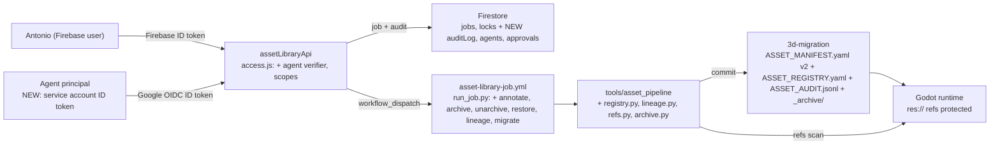
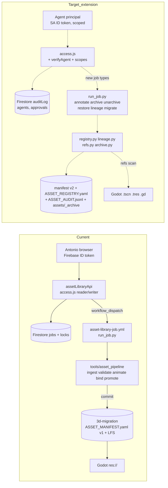

# 03 · Final implementation specification

_Part of the [RigCheck Asset Pipeline Audit](README.md). Exported verbatim from the Grok Bot Page "RigCheck Asset Pipeline Audit" on Oct 30, 2026. Docs only; nothing here has been implemented._

## Final implementation plan

> _(info)_
>
> For the coding agent. This extends the existing pipeline (manifest + tools/asset_pipeline + run_job.py + assetLibraryApi). It doesn't replace it. Every mutation still lands as a Git commit on 3d-migration made by the existing workflow. Constraints: no automatic permanent deletion; promotion and replacement need a human; agents never use Antonio's Firebase session. Line refs are from invasion-godot 3d-migration @ 1f1b2a4 and rigchecks-3d main @ f8c347a. Re-check them before editing.

### 1. Architecture: current vs target

Current: a browser (Firebase user) calls assetLibraryApi. It locks, writes a Firestore job, and dispatches asset-library-job.yml. run_job.py runs tools/asset_pipeline on 3d-migration and commits the manifest and LFS files. The target adds a registry layer (roles → characters → components), lineage fields on revisions, an append-only audit log, an archive store, and a second auth path for agents. The ingest, validate, animate, bind and promote paths stay as they are.

Diagram (rendered on the Page; nodes and edges reproduced verbatim):



| Node | Label | Detail | Kind |
| --- | --- | --- | --- |
| user | Antonio (Firebase user) |  | person |
| agent | Agent principal | NEW: service account ID token | person |
| api | assetLibraryApi | access.js: + agent verifier, scopes |  |
| fs | Firestore | jobs, locks + NEW auditLog, agents, approvals |  |
| gha | asset-library-job.yml | run_job.py: + annotate, archive, unarchive, restore, lineage, migrate |  |
| pipe | tools/asset_pipeline | + registry.py, lineage.py, refs.py, archive.py |  |
| repo | 3d-migration | ASSET_MANIFEST.yaml v2 + ASSET_REGISTRY.yaml + ASSET_AUDIT.jsonl + _archive/ |  |
| godot | Godot runtime | res:// refs protected |  |

| From | To | Label |
| --- | --- | --- |
| user | api | Firebase ID token |
| agent | api | Google OIDC ID token |
| api | fs | job + audit |
| api | gha | workflow_dispatch |
| gha | pipe |  |
| pipe | repo | commit |
| repo | godot |  |
| pipe | godot | refs scan |

Mermaid source (dashed or NEW = added; everything else exists today):



### 2. Files and functions to change

> _(warning)_
>
> Read these files in full before editing. I could only read heads or partial views because the connector truncates: docs/ASSET_MANIFEST.yaml (189 KB), tools/asset_pipeline/core.py (past about 7 KB: promote_asset internals, bind), manifest.py, motion.py, common.py, cli.py, .github/asset-library/run_job.py, .github/workflows/asset-library-job.yml, docs/ASSET_MANIFEST.schema.json (if present), and rigchecks-3d dist/asset-library.js (very large).

invasion-godot (branch 3d-migration; the workflow file lives on main)

| File | Function / location | Change |
| --- | --- | --- |
| tools/asset_pipeline/common.py | STATES (canonical, candidate, superseded) | Add LIFECYCLE_STATES = candidate, canonical, superseded, rejected, archived, abandoned. Add CHANGE_KINDS, MANIFEST_SCHEMA_VERSION = 2, and the allowed transitions table. Keep the old STATES as an alias for readers. |
| tools/asset_pipeline/core.py | make_revision L106-114 | Accept parent_revision, change_kind, skeleton_ref and provenance (actor, actor_kind, job_id, source, creator, note). Default lifecycle_state = candidate. |
| tools/asset_pipeline/core.py | ingest_asset L149-264 (unknown id creates a new asset at ~L176-181; identical-content rejection at ~L214-217) | Before creating a new asset, resolve aliases through registry.py. Run duplicate_check; on high confidence, refuse with DUPLICATE_IDENTITY unless allow_new_identity plus approval_id is passed. Store the provenance fields. Keep the {asset_id}{ext} filename, but also store original_filename. |
| tools/asset_pipeline/core.py | promote_asset L265+ (candidate-only ~L280; DESTINATION_EXISTS) | Require approval_id (a human approval record). Set the previous canonical to superseded and write superseded_by/supersedes. Write an audit entry. Agents can never call this. |
| tools/asset_pipeline/manifest.py | load/save/validate (read in full) | Schema v2 validation, migration hook, and stable key ordering (so diffs stay small). |
| tools/asset_pipeline/registry.py (NEW) | load_registry, resolve_alias, character_for, roles_for | Reads and writes docs/ASSET_REGISTRY.yaml. |
| tools/asset_pipeline/lineage.py (NEW) | glb_fingerprint, duplicate_check, lineage_graph, compat_matrix | Implements the identity procedure (texture sha256, mesh stats, bone set, rest pose). |
| tools/asset_pipeline/refs.py (NEW) | scan_references(paths) | Scans .gd, .tscn, .tres, .import, project.godot, the manifest (runtime_path, bindings, component_canonicals) and the registry for res:// and repo paths. |
| tools/asset_pipeline/archive.py (NEW) | archive_revision, unarchive_revision, restore_revision | Moves files with git mv to assets/_archive/<asset>/<rev>/ and writes an archive record. Unarchive moves them back. Never deletes. |
| tools/asset_pipeline/audit.py (NEW) | append_audit | Appends to docs/ASSET_AUDIT.jsonl in the same commit as the change. |
| tools/asset_pipeline/migrate_v2.py (NEW) | migrate(dry_run) | See section 4. |
| tools/asset_pipeline/cli.py | subcommands | Add annotate, archive, unarchive, restore, duplicate-check, lineage, refs, migrate. |
| tools/asset_pipeline/motion.py | (read in full) | Record skeleton_ref and clip compatibility on animation_collection revisions. |
| .github/asset-library/run_job.py | job dispatch (read in full) | Route the new job types. Fail closed on an unknown type. Pass actor and actor_kind into the audit entry. |
| .github/workflows/asset-library-job.yml | inputs | Add a job_type enum value for each new op. Keep the RIGCHECK_SHA pin. Add permissions: id-token: write only if GitHub OIDC is used later. |
| scripts/Operator3D.gd | L14 COMMITTED_MODEL_PATH | No change now. refs.py must treat it as a protected reference. A later, human-approved change moves it to a stable alias path. |
| docs/ASSET_REGISTRY.yaml, docs/ASSET_AUDIT.jsonl, assets/_archive/.gitkeep (NEW) | - | New data files. |

rigchecks-3d (main)

| File | Function / location | Change |
| --- | --- | --- |
| functions/src/app.js | routes L74-172 | Add POST /annotate, /archive, /unarchive, /restore, /duplicate-check, GET /lineage/:assetId, GET /audit. Approvals: POST /approvals, POST /approvals/:id/decide. |
| functions/src/access.js | bearer verification, assetLibraryRole reader/writer | Add verifyAgent (a Google-signed ID token with the function URL as audience and an allowlisted SA email). Return principal = {kind: human\|agent, id, roles, scopes}. Add requireScope(scope). |
| functions/src/jobs.js | componentOf L33-34, findRevision L37 | Make them lifecycle- and alias-aware. |
| functions/src/jobs.js | createdBy L136/154 | Store principal.kind and id. Write an auditLog doc for every job state change. |
| functions/src/jobs.js | dispatch L239 | Accept the new job types. Per-principal rate limit (agents lower than 20/hour). |
| functions/src/jobs.js | startIngest L284 (fields L286) | Add parent_revision, change_kind, skeleton_ref and allow_new_identity. Call duplicate-check first. |
| functions/src/jobs.js | startAnimate L390/400, startBind L424/447-450 | Record skeleton_ref compatibility. Agents get only a candidate bind, never canonical. |
| functions/src/jobs.js | promote confirm L500-545 (same-uid check L508) | Require a human principal plus an approved approval doc. Reject agents with 403 HUMAN_APPROVAL_REQUIRED. |
| functions/src/config.js | constants | AGENT_PRINCIPALS lookup collection name, agent rate limits, FUNCTION_AUDIENCE. |
| functions/scripts/set-asset-role.mjs | - | Add an assetLibraryRole approver. Add a sibling register-agent.mjs that writes agents/{id}. |
| dist/lib/asset-components.js | suggestParent L44-62, suggestComponent L65-91, manifestHashes L94 | Call /duplicate-check and show parent, confidence and change_kind. Show aliases. |
| dist/asset-library.js | suggestedId L1709, L1851 | Suggest the canonical character id through aliases instead of the filename stem (the bigguy case). Add archive/annotate/lineage UI. |
| dist/cloud-library.js | deleteModel L524-530 (permanent delete) | Replace with soft delete (archived flag plus a 30-day Storage hold). Keep permanent delete only behind a human confirm. |
| lib/firebase-cloud.mjs | exact sha256 duplicate L100-113 | Keep. Also add a near-duplicate warning from the duplicate-check response. |

### 3. Data schemas

Registry: docs/ASSET_REGISTRY.yaml (new, JSON-subset YAML like the manifest)

```yaml
schema_version: 1
characters:
  futuristic_suit:
    display_name: "Futuristic Suit (Operator)"
    asset_id: futuristic_suit            # manifest asset key
    aliases: [bigguy]                    # resolved before new-identity creation
    alias_candidates:                    # pending, never auto-merged
      - {name: suit4_walks, evidence: "65 bones, ~19MB", confidence: medium_low, status: pending}
      - {name: combat_suit_rigged, evidence: "65 bones", confidence: medium_low, status: pending}
    skeletons:
      suitrig_63: {revision: r_f45648e7..., signature: "8f90068d...847760", bones: 63}
      walkcodex_23: {revision: <b2a17261 full id>, bones: 23, state: superseded}
    animation_libraries: [operator_core, operator_repair]
roles:
  heavy_gunner:   {character: futuristic_suit, kind: role_variant, overrides: {animation_set: gunner, loadout: heavy}}
  combat_engineer:{character: futuristic_suit, kind: role_variant, overrides: {animation_set: engineer}}
  recon:          {character: futuristic_suit, kind: role_variant, overrides: {animation_set: recon}}
animation_libraries:
  operator_repair: {skeleton: suitrig_63, revisions: [r_a86fda1a3ac3475a]}
```

Revision record (manifest v2, added fields on each revision)

```json
{
  "revision_id": "r_<16 hex of sha256>",
  "asset_id": "futuristic_suit",
  "component": "model|rig|animation_collection|source_clip|materials|mechanical",
  "lifecycle_state": "candidate|canonical|superseded|rejected|archived|abandoned",
  "parent_revision": "r_... | null",
  "change_kind": "initial|model_fix|skeleton_upgrade|rerig|animation_revision|material_revision|reexport|import_backfill",
  "skeleton_ref": {"revision": "r_f45648...", "signature": "8f90...", "bone_count": 63},
  "fingerprint": {"sha256": "...", "tris": 473566, "verts": 258011,
                  "texture_sha256": ["..."], "bone_set_sha256": "...", "rest_pose_sha256": "...(name-sorted)"},
  "compat": [{"target": "r_f45648...", "result": "compatible|retarget_needed|incompatible",
              "by": "bone_names|rest_pose|joint_order", "checked_by": "lineage.py@<sha>"}],
  "supersedes": "r_...|null", "superseded_by": "r_...|null",
  "provenance": {"actor": "human:<uid>|agent:<id>|backfill", "job_id": "...",
                 "source": "...", "original_filename": "...", "creator": "...", "note": "...",
                 "created_at": "ISO8601|null"},
  "annotations": [{"at": "ISO8601", "actor": "...", "fields": {"note": "..."}}],
  "archive": null
}
```

Allowed lifecycle transitions: candidate→canonical (human), candidate→rejected, candidate→abandoned, canonical→superseded (only through promotion of another), any non-canonical→archived, archived→previous state (unarchive). canonical→archived is forbidden.

Dependency edge (computed by lineage.py and refs.py, cached in the lineage response, not stored by hand)

```json
{"from": "r_a86fda1a...", "to": "r_f45648...",
 "kind": "parent|skeleton_ref|binding|component_canonical|godot_ref|manifest_path|role_override",
 "location": "scripts/Operator3D.gd:14 | manifest:bindings.repair | ...",
 "blocking": true}
```

Archive record (on the revision and in assets/_archive/<asset>/<rev>/ARCHIVE.json)

```json
{"archived_at": "ISO8601", "archived_by": "agent:asset-curator", "job_id": "...",
 "reason": "superseded_unreferenced", "previous_state": "superseded",
 "moved": [{"from": "assets/_workbench/...", "to": "assets/_archive/...", "sha256": "..."}],
 "dependency_check": {"tool": "refs.py@<sha>", "edges_found": 0, "scanned_commit": "<sha>"},
 "restorable": true}
```

Audit-log entry (docs/ASSET_AUDIT.jsonl, one line each, plus a Firestore auditLog mirror)

```json
{"id": "uuid", "at": "ISO8601", "principal": {"kind": "human|agent|backfill", "id": "..."},
 "action": "ingest|annotate|archive|unarchive|restore|promote|migrate|approve|reject",
 "target": {"asset_id": "...", "revision_id": "..."}, "job_id": "...",
 "workflow_run": 41018342222, "commit": "<sha>|null", "approval_id": "...|null",
 "before": {...}, "after": {...}, "result": "ok|refused|error", "reason": "..."}
```

Agent identity and claims (Firestore agents/<agentId>)

```json
{"agent_id": "asset-curator", "principal": "asset-curator@rigcheck-cfbe3.iam.gserviceaccount.com",
 "owner": "<Antonio uid>", "phase": 1,
 "scopes": ["library:read", "lineage:read", "duplicate:check", "annotate:write"],
 "rate_limit_per_hour": 10, "disabled": false, "created_at": "...", "expires_at": "..."}
```

Scopes: library:read, lineage:read, duplicate:check, annotate:write, ingest:candidate, bind:candidate, archive:write, unarchive:write, approval:request. promote and archive:permanent are never grantable to agents.

### 4. Migration

1. Bump: manifest schema_version 1→2 (add the field at the top if it's absent). Readers accept v1 and v2 for one release; writers write v2 only.
2. Field mapping: canonical_state→lifecycle_state (same values). supersedes/superseded_by unchanged. New fields default to null. Keep canonical_state written alongside for one release, for old readers.
3. migrate_v2.py --dry-run prints a unified diff of the manifest and registry plus a summary (revisions touched, fields set, warnings), and exits 0 without writing. --apply writes the files and one audit entry (action migrate, principal backfill).
4. Idempotency: every backfill item is keyed (revision_id, field). It's skipped if the value already equals the target. A second --apply produces no diff (a test asserts this). Unknown or ambiguous items produce warnings, never guesses.
5. Rollback: the migration is one commit. To roll back, git revert that commit, run by the job runner as job type migrate_rollback with human approval. migrate_v2.py --rollback also strips v2-only fields and restores schema_version 1 from the pre-migration snapshot stored at docs/migrations/v2_pre.json (the sha256 is recorded in the audit entry).

Backfill set (exact full revision IDs must be read from the manifest; the short IDs here are what the audit saw):

| Revision | Set | Evidence level |
| --- | --- | --- |
| b674ad0b… (rigged source) | change_kind initial, lifecycle superseded, note 'rigged source of WalkCodex' | Low. The coding agent must confirm from the manifest; if unclear, only add a note. |
| b2a17261… (23-bone WalkCodex) | parent_revision b674ad0b (if confirmed), change_kind rerig, lifecycle superseded, skeleton_ref walkcodex_23 | Medium |
| be0ffd97… (heavy_gunner walk) | parent b2a17261, change_kind animation_revision, role heavy_gunner. Mark as an archive candidate (not archived by the migration). | Medium |
| r_f45648… (bigguy 63-bone, canonical) | parent b2a17261, change_kind skeleton_upgrade, alias bigguy, fingerprint | High (texture blobs match) |
| 5th futuristic_suit revision (whatever the full manifest shows) | Classify with lineage.py. If the result isn't high confidence, leave parent null and add a warning. | Unknown, not read |
| r_a86fda1a3ac3475a | skeleton_ref suitrig_63 / r_f45648. provenance.source 'repair_weld_collection.glb (Grok Bot, uploaded via website in Antonio's session)', provenance.actor human:<Antonio uid> (from Firestore job cb939793), annotation 'contains Grip_R_Pistol, Repair_Weld, Repair_Weld_Upper'. compat: compatible by bone_names with r_f45648; joint_order differs. | High |
| Probe revisions (test/probe ingests in the manifest) | lifecycle abandoned, note 'pipeline probe'. Archived later only through the dependency-checked path. | Coding agent must list them from the full manifest |

### 5. API and job types

| Endpoint | Request | Response | Roles / scope | GHA job_type |
| --- | --- | --- | --- | --- |
| POST /annotate | {assetId, revisionId, fields: {note?, source?, creator?, tags?}, baseSha} | 202 {jobId} | writer; agent annotate:write | annotate |
| POST /archive | {assetId, revisionId, reason, baseSha, dryRun?} | dryRun: 200 {edges[], safe, plan}. Otherwise 202 {jobId}, or 409 REFERENCED {edges} | writer; agent archive:write (phase 3, only if safe) | archive |
| POST /unarchive | {assetId, revisionId, baseSha} | 202 {jobId} | writer; agent unarchive:write | unarchive |
| POST /restore | {assetId, revisionId, makeCanonical: bool, approvalId?} | 202 {jobId}; makeCanonical without an approved approval is 403 | writer; makeCanonical needs approver plus a human | restore |
| POST /duplicate-check | {sha256, fingerprint?} or {uploadPath} | 200 {exact?: rev, candidates: [{assetId, revisionId, change_kind, confidence, evidence}]} | reader; agent duplicate:check | none (sync), or lineage for a full GLB scan |
| GET /lineage/:assetId | - | 200 {revisions[], edges[], compat[], aliases[], roles[]} | reader; agent lineage:read | none (reads manifest at HEAD) |
| GET /audit?assetId&since&limit | - | 200 {entries[]} | reader | none |
| POST /approvals; POST /approvals/:id/decide | {action: promote\|restore_canonical\|replace\|alias_merge, target, rationale}; {decision: approve\|reject} | 201 {approvalId}; 200 | request: writer or agent approval:request. decide: approver human only | none |
| Existing: /ingest, /promote, /bind, /animate, /validate | Add the fields from section 2 | Unchanged, plus a principal in the job doc | promote: human plus an approvalId | existing |

Errors: 400 INVALID, 401, 403 SCOPE or HUMAN_APPROVAL_REQUIRED, 409 STALE_BASE_SHA, REFERENCED, DUPLICATE_IDENTITY or LOCKED, 429 RATE_LIMIT. Every response includes auditId.

### 6. Agent authentication

| Option | How | Pros | Cons |
| --- | --- | --- | --- |
| A. Firebase user + custom claims | A dedicated Firebase Auth user per agent with claims {agent: true, scopes}. The agent holds a refresh token and exchanges it for 1-hour ID tokens. | No change to access.js token verification. | The refresh token is long-lived and hard to scope or rotate. It looks like a human user. Claims refresh lags up to 1 hour. |
| B. Service account + short-lived tokens (recommended) | One SA per agent (e.g. asset-curator@rigcheck-cfbe3). The agent gets a Google-signed ID token (audience = function URL, 1-hour expiry), ideally through Workload Identity Federation or impersonation, falling back to an SA key. access.js verifies the token and looks up agents/{id}. | Clearly not a human. Scopes live server-side and revoke instantly (disabled flag). IAM audit logs plus our audit. Keyless where WIF is available. | A new verifier path in access.js. If keyless isn't possible on the agent host, an SA key must be stored and rotated. |
| C. GitHub OIDC | A workflow requests an OIDC token (id-token: write). The Function verifies issuer token.actions.githubusercontent.com and repo/ref/workflow claims. | No secrets at all. | Only for agents that run inside GitHub Actions. Doesn't fit Grok Bot or Opus running elsewhere. |

- **Recommendation**: B for external agents. Add C later for agents that run as workflows. Never A, and never Antonio's session.
- **Scopes per phase**: Phase 1: library:read, lineage:read, duplicate:check. Phase 2: + annotate:write, approval:request. Phase 3: + archive:write, unarchive:write (dependency-checked only), ingest:candidate, bind:candidate. Never: promote, restore_canonical, permanent delete, role changes.
- **Secret storage**: Prefer keyless (WIF or impersonation). If a key is needed, store it in the agent host's secret vault, never in the repo, Firestore or chat. Function-side GitHub token stays in Secret Manager as today.
- **Rotation**: SA keys every 90 days, overlapping (create the new key, deploy, delete the old). ID tokens expire in 1 hour. agents/{id}.expires_at forces review.
- **Revocation**: Set agents/{id}.disabled = true; this takes effect on the next request. Disable or delete the SA key in IAM. Both are written to the audit log.
- **Audit**: Each request writes principal, scope used and result to Firestore auditLog. Each committed change also goes to ASSET_AUDIT.jsonl with job_id and workflow run. GitHub actor stays pizzarolls510 (the token owner), so attribution comes from our log, not git.

### 7. Safeguards

1. Dependency check before archive. refs.py scans at the job's baseSha: every .gd, .tscn, .tres, .import and project.godot for res:// paths and preload/load strings; manifest runtime_path, bindings, component_canonicals, supersedes chains and skeleton_ref; registry roles and animation_libraries. Any blocking edge gives 409 REFERENCED, and nothing moves.
2. Protected references. The canonical of any component is never archivable. Any file referenced by res:// (e.g. Operator3D.gd:14 futuristic_suit_walk_codex.glb) is protected even if its revision is superseded. Its .import sidecar and textures move or stay together.
3. Reversible only. Archive is a git mv into assets/_archive with ARCHIVE.json. Unarchive reverses it. Nothing is deleted. Cloud Library delete becomes a soft delete.
4. Human approval gate. promote, restore with makeCanonical, replace, alias merges and role changes need an approvals doc decided by an approver human. Jobs re-check it at run time (not just at request).
5. Duplicate-identity gate. Ingest of an unknown asset id with a high-confidence match is refused unless approved.
6. Stale-state protection. baseSha must equal the 3d-migration HEAD (existing lock plus 409).
7. Blast radius. At most N archives per job (default 5). Per-agent rate limit. A kill switch in config (AGENT_WRITES_ENABLED).

### 8. Tests and acceptance criteria

Fixtures: tests/fixtures/glb/ with small synthetic GLBs. Include: a mesh with a 63-bone skin; the same mesh with joint order permuted; the same with +1% vertices; a 23-bone version; a different mesh with different textures; an animation-only GLB with a 3-vertex placeholder (like r_a86fda1a). Add a v1 manifest snapshot covering futuristic_suit plus probes, and a mini Godot project tree with res:// references.

| Item | Unit | Integration / e2e | Acceptance |
| --- | --- | --- | --- |
| Lineage / duplicate-check | Fingerprint stable. Joint-order permutation still counts as the same skeleton. Thresholds classify each fixture correctly. | /duplicate-check on bigguy's sha returns exact r_f45648. hands_walks returns parent r_f45648, model_fix, high. | No false 'new character' result for any futuristic_suit fixture. scifi-like fixture is never auto-aliased. |
| Registry / aliases | resolve_alias(bigguy) = futuristic_suit. Role lookup works. | Ingest with assetId bigguy lands on futuristic_suit (or is refused with a suggestion). | No duplicate identity is created. |
| Revision schema / lifecycle | Allowed transitions only. canonical→archived refused. | Schema validation of the full v2 manifest. | Manifest validates. Old readers still load it. |
| Migration | Every backfill rule. Ambiguous input gives a warning. | dry-run shows a diff with no write. apply then apply again gives no second diff. rollback restores the v1 bytes (sha256 equal). | All three pass on a copy of the real manifest. |
| Annotate | Only whitelisted fields. Annotations are appended, never replaced. | r_a86fda1a annotated through the API in staging. | The record shows the source; the audit entry exists. |
| Archive / unarchive / restore | refs.py finds res://, manifest and binding refs. | Archiving a referenced revision gives 409 with edges. Unreferenced: files moved, then unarchive restores byte-identical files. | Zero deletions in the git diff. Godot project still opens (headless import check). |
| Auth | verifyAgent rejects a wrong audience, expired token, disabled agent, or missing scope. | An agent calling promote gets 403. A human without approval gets 403. | Every request has an audit row with a principal. |
| Audit | JSONL append-only, schema-valid. | Every job type writes exactly one committed entry. | GET /audit reproduces the history of r_a86fda1a. |
| e2e (staging Firebase project + a fork branch) | - | Agent: duplicate-check, annotate, archive dry-run, archive, unarchive. Human: approve and promote a fixture candidate. Then roll back. | Runs green twice in a row. Production manifest untouched. |

### 9. Phased rollout

| Phase | Scope | Agents may do autonomously | Exit criteria | Effort |
| --- | --- | --- | --- | --- |
| 0. Read fully, design check | Opus reads the truncated files and reviews this plan. Updates line refs. | Read only | Plan diff accepted by Antonio | 0.5 day |
| 1. Schemas + lineage (read-only features) | common.py, registry.py, lineage.py, refs.py, schema v2 readers, /duplicate-check, /lineage, /audit, agent verifier | Read, lineage, duplicate-check | Unit and integration tests green. No write paths changed. | 3-4 days |
| 2. Migration + annotate | migrate_v2.py, audit.py, /annotate, approvals collection | Annotate; request approvals | Dry-run reviewed by Antonio. Applied by a human-triggered job. Rollback rehearsed on a branch. | 2-3 days |
| 3. Archive / unarchive / restore | archive.py, /archive, /unarchive, /restore, Cloud Library soft delete | Archive only when refs.py proves zero blocking edges; unarchive | e2e green. 1 week of agent dry-runs reviewed before real archives. | 3-4 days |
| 4. Gated promotion and UI | Approval-gated promote/restore/replace, website lineage and alias UI | Nothing new. Promotion stays human. | Antonio approves one real promotion end-to-end | 2-3 days |

### 10. Risks, effort, open questions

| Risk | Mitigation |
| --- | --- |
| Missing a reference and archiving a used file | refs.py plus the canonical never-archive rule plus dry-run first. Archive is reversible. A Godot headless import check runs in CI. |
| Wrong lineage backfill | Only high-confidence items get parent links. Others get notes and warnings. The migration is revertible. |
| Large manifest diffs or merge conflicts | Stable key ordering. One job at a time via the existing lock. |
| Agent credential leak | Keyless first, narrow scopes, rate limits, kill switch, instant disable. |
| Line refs drift | Phase 0 re-reads every file. |
| Old website / Function readers break on v2 | Dual-write canonical_state for one release. |

Total effort: about 11-15 working days for one agent, including tests.

1. Which full IDs are the 5 futuristic_suit revisions and the probes? To be read from the full manifest in phase 0.
2. suit4 / combat_suit / scifi_suit: export them from the Cloud Library so lineage.py can classify them. Until then they stay pending.
3. Keyless agent auth: can the agent host do Workload Identity Federation? If not, accept an SA key with 90-day rotation?
4. Who besides Antonio gets the approver role?
5. Should Operator3D.gd move from futuristic_suit_walk_codex.glb to a stable alias path, and when? This needs a human decision.
6. Is Cloud Library soft-delete retention 30 days OK?

## What I could not verify

- **Full manifest**: The GitHub connector truncates files at about 7 KB (the manifest is 189 KB), and the box has no gh or git credentials, so I didn't clone. The r_a86fda1a record was read from the 1f1b2a4 commit diff (the first 20 KB of it). Older revisions' bone and clip counts come from earlier sessions, locally saved Oct 17 copies of the repo docs (rules, plan, status and the reconciliation doc) and file hashes, not from a full manifest read.
- **Code past about 7 KB**: The tails of core.py (promotion internals, bind), manifest.py, motion.py and run_job.py weren't readable. The findings rely on their heads plus the docs.
- **Firestore job record for r_a86fda1a**: The submitting uid is stored only in Firestore (jobs.js createdBy), which I can't read. The submitter is established from the Grok Bot session transcript and the workflow run timing instead. The rest of the diff (per-model compatibility classification) was cut off by the connector.
- **Cloud Library listing**: Not re-checked; it needs the signed-in Firebase session. The suit4, combat_suit and scifi_suit files weren't available, so their lineage rests on earlier card data (bone counts, size).
- **23-bone futuristic_suit mesh**: Texture identity is proven by git blob SHA. The WalkCodex GLB itself (19.85 MB) wasn't downloaded, so its vertex positions and bone names weren't compared. The 473,566 tri count comes from the manifest via earlier reads.
- **Full revision IDs**: b2a17261, be0ffd97 and b674ad0b are short prefixes from earlier reads. The fifth futuristic_suit revision and the probe list need the full manifest.
- **rigchecks-3d freshness**: git pull reported the checkout as up to date at f8c347a (Oct 12). The workflow pins RigCheck at df276ed, which is an ancestor of f8c347a.
